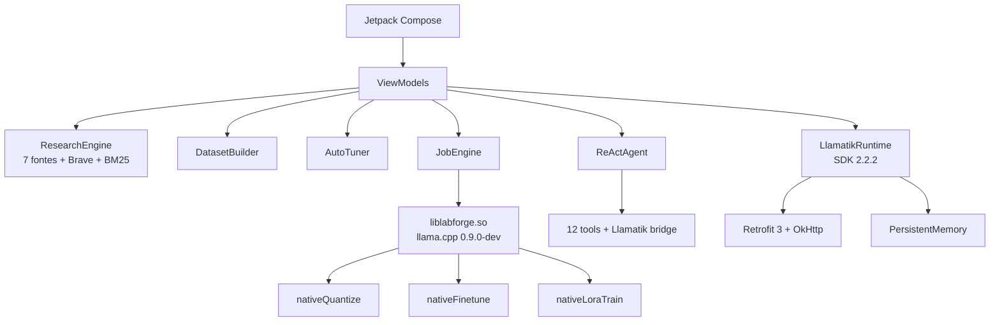

# Girassol

**Estúdio Android de GGUF, importance matrix e LoRA nativo — com pesquisa autônoma, Codex e agentes.**

<p align="center">
  
</p>

<p align="center">
  <a href="https://github.com/Enhikyy/girassol/actions/workflows/android.yml"></a>
  
  
  
  
  
</p>

<p align="center">
  
</p>

<p align="center">
  <b>Pesquise. Aprenda. Faça florescer.</b><br/>
  <sub>Pesquisa em APIs gratuitas → download e ingestão textual → currículo → dataset → auto-tuning → LoRA no dispositivo.</sub>
</p>

---

## Download

O APK é gerado pelo GitHub Actions em cada push:

1. abra **Actions → Android CI → último run**;
2. baixe o artifact **`girassol-debug-apk`**;
3. ou baixe a release assinada em **Releases** (tags `v*`).

```bash
adb install -r app-debug.apk
```

> Requer Android 8.0+ (API 26) e **arm64-v8a**. O APK tem ~36 MB.

> **CI:** o workflow está em [`ci/android.yml`](ci/android.yml). O workflow executa build e testes; falhas nos testes bloqueiam a entrega.

---

## O que é

O Girassol transforma o celular em um laboratório de modelos locais:

| Área | O que faz |
|---|---|
| **GGUF** | Lê header, metadados, tensores, quantização, tamanho por camada e arquitetura. |
| **Imatrix** | Lê importance matrix em GGUF e no formato legado `.dat`; usa no `llama_model_quantize`. |
| **Quantização** | Executa o quantizador nativo do llama.cpp no dispositivo, com presets K-quants e I-quants. |
| **Fine-tuning** | Treino completo (AdamW) com checkpoints, loss, amostras e retomada. |
| **LoRA nativo** | Base congelada + adapters A/B via llama.cpp; validação de loss e reload do adapter. |
| **Autoestudo** | Pesquisa 9 fontes gratuitas, mais GitHub e Brave Search opcionais, deduplica/ranqueia, monta RAG BM25, currículo, dataset e preset. |
| **Auto-tuning** | rank, alpha, epochs, lr, contexto, alvos e ETA calculados a partir do corpus e da RAM. |
| **Piloto automático** | Repete pesquisa, ingestão textual, dataset e autoajuste em ciclos configuráveis; persiste métricas e mostra gráficos de evolução. |
| **Codex** | Agente de código com plano, edição de arquivos, shell, Git e revisão. |
| **Chat ReAct** | Agente com 12 ferramentas, memória, pesquisa web, cálculo, data e APIs públicas. |
| **GitHub** | Agente busca repositórios e código, lê arquivos e issues, clona, cria branch, faz push e abre issues/PRs com o token configurado em Ajustes. |
| **Llamatik** | SDK de agentes 2.2.2 integrado: tools, executor, permissões, memória persistente e streaming. |
<!-- coderabbit-ai-generated:v1 -->

<!-- coderabbit-ai-generated-section:v1:34589c5ea60e0aa3e321d959e777ea59158cde202e4590e59e3c6e601fde6df5 -->

**RAM:** mede a variação de memória e limpa caches do Girassol. Android 14+ não permite encerrar outros aplicativos; em versões anteriores, solicitações podem ser ignoradas.

<!-- /coderabbit-ai-generated:v1 -->

### Sem chave de API

A pesquisa usa **Wikipedia (pt/en), OpenAlex, arXiv, Stack Overflow, DuckDuckGo e Semantic Scholar** sem chave. Se nenhum LLM estiver configurado, o autoestudo cai para **síntese extrativa ancorada nas fontes** — ele não inventa conteúdo.

---

## Capturas

> Mockups de design em `design/screenshots/` (não são capturas de tela do dispositivo).

<p align="center">
  
  
  
  
</p>
<p align="center">
  
  
  
  
</p>

---

## Arquitetura



### Estrutura

```text
app/src/main/java/dev/labforge/app/
├── core/
│   ├── gguf/            parser GGUF e metadados
│   ├── imatrix/         GGUF + .dat legado
│   ├── native/          ponte JNI (LlamaBridge)
│   ├── train/           dataset, auto-tuner, presets
│   ├── research/        APIs gratuitas, BM25, engine
│   ├── agent/           ReAct, LLM client, ferramentas
│   ├── codex/           agente de código
│   ├── job/             fila e progresso
│   └── model/           catálogo local
├── integration/
│   ├── api/             Retrofit + PublicApiTool
│   └── llamatik/        ToolRegistry, executor, memória
├── service/             GirassolService + MemoryGuard/Booster
├── ui/                  Compose, tema, componentes
└── vm/                  ViewModels
```

Detalhes em [`docs/ARCHITECTURE.md`](docs/ARCHITECTURE.md).

---

## Build

### Requisitos

- JDK **21**
- Android SDK **platform 37.0**, build-tools **37.0.0**
- Gradle wrapper **9.9.0** (incluído)
- AGP **9.5.1**, Kotlin **2.3.21**

```bash
export JAVA_HOME=/caminho/jdk-21
export ANDROID_HOME=/caminho/android-sdk

./gradlew :app:assembleDebug --no-daemon
# app/build/outputs/apk/debug/app-debug.apk
```

### Testes

```bash
./gradlew :app:testDebugUnitTest
LIVE_API=1 ./gradlew :app:testDebugUnitTest --rerun-tasks
```

Cobertura atual: **25 testes**, incluindo parser GGUF, imatrix, pesquisa real nas 5 APIs, fluxo completo do autoestudo, UI Compose, Llamatik, Retrofit e API 26.

### CI

`.github/workflows/android.yml`:

- instala JDK 21 + SDK 37;
- roda os testes;
- gera o APK de debug;
- publica o artifact `Girassol-APK`;
- em tags `v*`, anexa o APK a uma GitHub Release.

Para gerar manualmente: **Actions → Android APK → Run workflow**.

---

## Llamatik 2.2.2

O app integra `com.llamatik:sdk:2.2.2` com:

- `ToolRegistry` + built-ins (`calculator`, `datetime`, `uuid`, `random`);
- `AgentExecutor` com `ToolPermissionRepository`, `AgentActionLogRepository` e `AlwaysEntitled`;
- `PersistentMemory` em arquivo;
- `AgentConfig` / `AgentStreamChunk`;
- tool `public_api_posts` via **Retrofit 3.0.0 + OkHttp 4.12.0 + kotlinx.serialization**;
- tool `research_web` reutilizando o motor gratuito;
- streaming token a token na tela **Llamatik Runtime**;
- ponte para o agente ReAct do Chat.

### Por que `com.llamatik:core` é excluído

O `core` nativo do Llamatik embarca **outro** llama.cpp (`libllama.so`, `libggml*.so`, `libllama_jni.so`, `libwhisper`, `libomp`) com os mesmos SONAMEs do motor do Girassol. Os dois não podem coexistir: colidiriam símbolos e quebrariam quantização/treino/LoRA.

O APK é validado por teste: `com.llamatik.core.platform.LlamaBridge` **não** existe e `libllama_jni.so` **não** é empacotado.

---

<!-- coderabbit-ai-generated:v1 -->

<!-- coderabbit-ai-generated-section:v1:73b49c17c546ab20d043e3b59cb6a7b3b560c63c75b542d7fb7e137e8681f7f9 -->

## Central de compilação

**Laboratório → Compilar** oferece diagnóstico, testes, lint, montagem e verificação de APK/assinatura, com logs por etapa, metadados SHA-256 e relatório persistido. A interface adaptável usa padrões Material pesquisados na documentação Flutter, implementados nativamente em Compose. Veja [uso, ambiente e limites](docs/BUILD_CENTER.md).

<!-- coderabbit-ai-generated:v1 -->

<!-- coderabbit-ai-generated-section:v1:87c3747a2ef34318f182dbaa9d5b38a0763bbec505d5111965ad15981341679b -->

## Modelos visuais nativos

A página inicial e o chat aplicam modelos abertos semelhantes às referências Figma, adaptados de Jetchat/Reply e Material Icons: destaque, grade de atalhos, sugestões, compositor e cartões expansíveis. [Modelos, downloads, licenças e cobertura](docs/VISUAL_TEMPLATES.md).

## Design

<!-- /coderabbit-ai-generated:v1 -->

<!-- /coderabbit-ai-generated:v1 -->

- Tema escuro “sunflower lab”: fundo `#070805`, superfícies `#13160F`, dourado `#F2C14E`, verde `#84D98A`.
- Tipografia sans (Inter/Roboto), títulos com tracking negativo.
- Componentes: aurora animada, glass cards, progress ring, donut, barras animadas, girassol spinner.

O arquivo do Figma é gerado pelo plugin em [`design/plugin`](design/plugin). Veja [`docs/FIGMA.md`](docs/FIGMA.md).

---

<!-- coderabbit-ai-generated:v1 -->

<!-- coderabbit-ai-generated-section:v1:b99971ba0f18495ed0f5695d1dc51d7f8c262ca29e1495f572afb48698b580ab -->

## Modo sono

<!-- coderabbit-ai-generated:v1 -->

<!-- coderabbit-ai-generated-section:v1:848c78442cf27a2234aad128f3889b21d7b245e2f6e0a25679e2404926000521 -->

Na tela de autoestudo, agende o modo sono. O WorkManager consolida lições e cria um corpus de repetição quando o dispositivo está carregando e inativo; com rede, pesquisa o tema e uma pergunta derivada das falhas registradas. O intervalo é de 12 horas, com horário definido pelo Android. A tarefa não inicia treino LoRA automaticamente.

<!-- coderabbit-ai-generated:v1 -->

<!-- coderabbit-ai-generated-section:v1:91a307bd2cbbb2c10f3bbd44368dac9b8a49886055f643e5677cdf5bf997bff0 -->

<!-- coderabbit-ai-generated:v1 -->

<!-- coderabbit-ai-generated-section:v1:567562da82c3963a72dfb142b949bb7f3ce263f9beae8dac8441c6618f4c0c7a -->

Chat, Codex, Llamatik e autoestudo podem usar inferência GGUF via JNI. Configure o modelo e os adaptadores em Ajustes. O fallback para API é opcional. O dispositivo opera **sem root**: Acessibilidade oferece automação da interface e a integração oficial RUN_COMMAND do Termux executa comandos, builds e testes. A instalação de APKs abre o instalador Android para confirmação. Consulte [Runtime nativo](docs/NATIVE_RUNTIME.md) para preparação e limites de implementação.

O novo painel **Laboratório → Evolução** apresenta habilidades observadas, recuperação de falhas e benchmark local de threads. O importador aceita arrays JSON Alpaca/ShareGPT. Consulte [Referências e implementação nativa](docs/REFERENCE_INTEGRATIONS.md) para o escopo verificado e as integrações ainda pendentes.

<!-- /coderabbit-ai-generated:v1 -->

<!-- /coderabbit-ai-generated:v1 -->

<!-- /coderabbit-ai-generated:v1 -->

## Limitações conhecidas

<!-- /coderabbit-ai-generated:v1 -->

- Apenas **arm64-v8a**; não roda em x86/emulador comum.
- O LoRA nativo exige modelo base **F32/F16/BF16**; modelos quantizados são ignorados no auto-treino.
- O `core` nativo do Llamatik fica de fora para preservar o motor de treino.
- Pesquisa e LLM dependem de rede; sem LLM, a síntese é extrativa.
- O APK de CI é assinado com a **debug keystore**; para distribuição, configure uma keystore de release.

---

## Licença

MIT — veja [`LICENSE`](LICENSE).

<p align="center"><sub>Feito para rodar no dispositivo. Sem servidor, sem telemetria.</sub></p>
