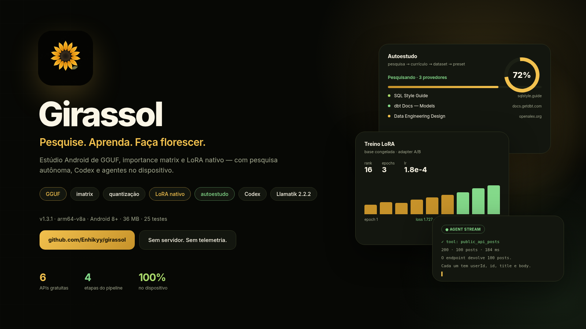
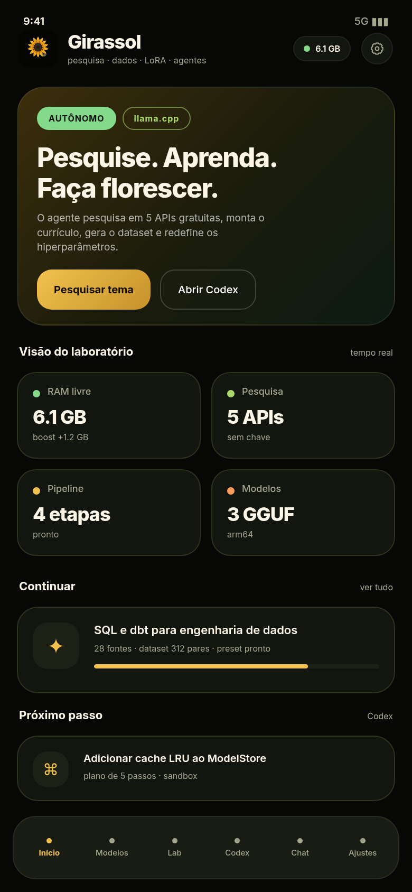
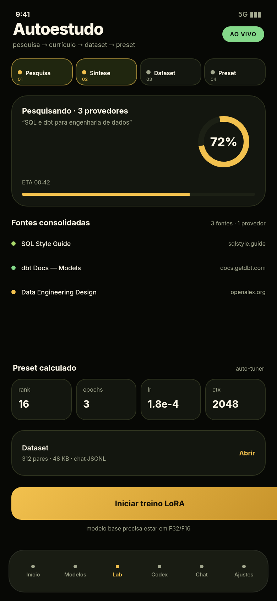
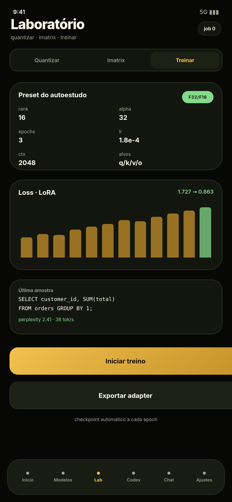
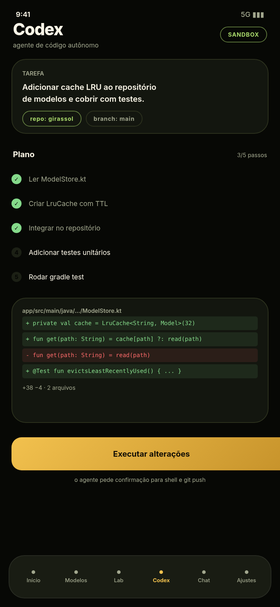
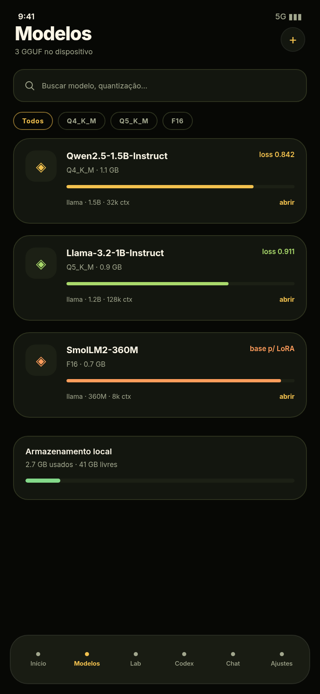
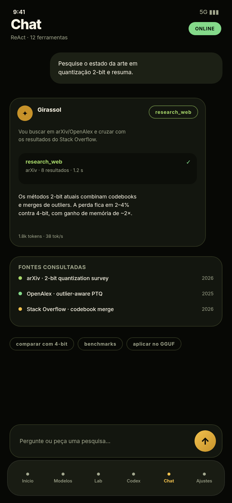
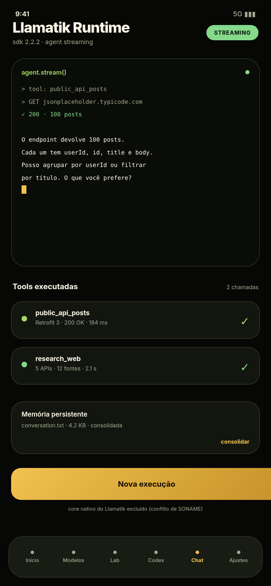
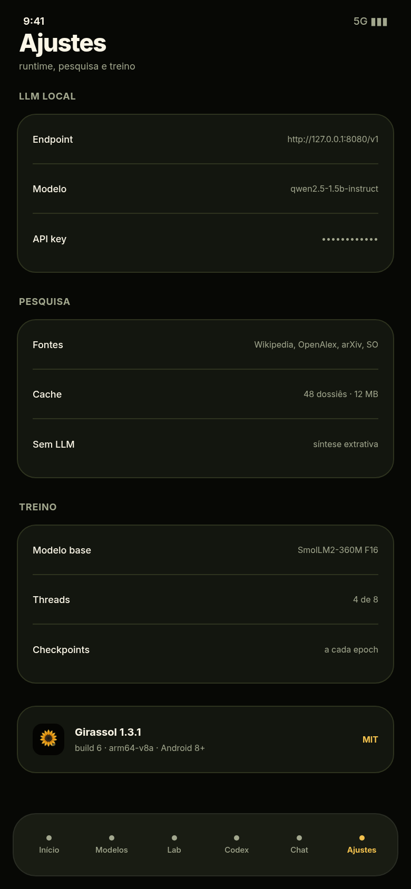
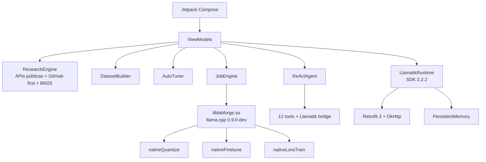

# Girassol

**Estúdio Android de GGUF, importance matrix e LoRA nativo — com pesquisa autônoma, Codex e agentes.**

<p align="center">
  
</p>

<p align="center">
  <a href="https://github.com/Enhikyy/girassol/actions/workflows/android.yml"></a>
  
  
  
</p>

<p align="center">
  
</p>

<p align="center">
  <b>Pesquise. Aprenda. Faça florescer.</b><br/>
  <sub>Pesquisa em APIs gratuitas → download e ingestão textual → currículo → dataset → auto-tuning → LoRA no dispositivo.</sub>
</p>

---

## Download

O APK é gerado pelo GitHub Actions em cada push:

1. abra **Actions → Android CI → último run**;
2. baixe o artifact **`girassol-debug-apk`**;
3. ou baixe a release assinada em **Releases** (tags `v*`).

```bash
adb install -r app-debug.apk
```

> Requer Android 8.0+ (API 26) e **arm64-v8a**. O workflow não impõe um teto artificial ao tamanho final do APK.

> **CI:** o workflow está em [`ci/android.yml`](ci/android.yml). O workflow executa build e testes; falhas nos testes bloqueiam a entrega.

---

## Estabilidade móvel e OLED (1.7.0)

- O perfil de treinamento adapta rank, contexto, alvos e threads à RAM realmente livre. Em aparelhos de 4 GB, privilegia LoRA de baixa memória; fine-tuning completo não é iniciado quando a margem de segurança não existe.
- O dataset é mantido completo no armazenamento; o motor nativo processa janelas rotativas limitadas de cada vez para reduzir picos de memória.
- O LoRA grava um checkpoint após cada época e observa pressão crítica de RAM para solicitar encerramento cooperativo.
- JNI usa um ambiente próprio por thread ao encaminhar logs nativos.
- Pure Black OLED aplica fundo preto e pausa os brilhos animados de fundo; gráficos de loss, métricas e fontes têm animação curta.
- A busca de projetos do GitHub lidera a pesquisa autônoma e baixa README de repositórios como fonte para síntese e dataset.

---

## Correção do treino LoRA em aparelhos com 4 GB

- Corrigida corrupção de heap nativo ao inicializar matrizes A/B de dimensões diferentes.
- O JNI LoRA agora converte falhas de alocação em resultados estruturados e libera recursos parcialmente criados.
- Perfil móvel padrão: rank 2, contexto 128, uma thread e somente atenção; o motor pode reduzir o contexto a 64.
- Orçamento arquitetural estimado de 200 MiB para buffers auxiliares do LoRA, excluindo o GGUF-base mapeado por mmap.
- Cada ciclo lê uma janela rotativa de 128 KiB do dataset, mantendo o corpus completo no disco.
- O log do job informa modelo/dataset, orçamento, parâmetros e amostras de RAM.

O teto de 200 MiB limita o working set **estimado** de buffers adicionais, não o RSS total do processo nem o tamanho dos modelos que podem ser carregados pelo Android.

---

## Inferência off-heap (mmap)

A inferência local e a base congelada do LoRA usam mapeamento de arquivo `LLAMA_LOAD_MODE_MMAP`, sem `mlock` e sem `android:largeHeap`. A inferência usa micro-batches de 2 tokens; em aparelhos com 4 GB o perfil limita contexto a 512 e threads a 2. O Chat exibe um aviso de risco na primeira execução e tenta um fallback compacto quando o JNI reporta falha de alocação. O log nativo confirma o arquivo em `/proc/self/maps`. Consulte [docs/OFFHEAP_MMAP.md](docs/OFFHEAP_MMAP.md) para Profiler/ADB e limites reais: mmap tira os pesos do heap Java, mas não elimina RSS, KV cache, ativações ou pressão de RAM.

## Continuidade de aprendizado (1.8.0)

O autoestudo mantém uma árvore de habilidades local, com pré-requisitos, revisão espaçada inspirada no algoritmo SM-2, histórico de experiências e consolidação offline idempotente de falhas e padrões recorrentes. O resultado do treino LoRA é registrado como evidência positiva ou como falha a revisar. A memória é local, limitada por quantidade e não substitui validação factual das fontes.

## Stack de pesquisa por referência

O catálogo GitHub-first associa tópicos aos READMEs permissivamente licenciados de labml, LLaMA Factory, MuonClip, Kimi Linear/KDA, Flash Linear Attention, lau-agent-dream, ZenBrain e UI-Voyager. A pesquisa ingere documentação e extrai ideias; ela não instala os runtimes Python, CUDA, Triton ou vLLM desses projetos no telefone.

Fontes sem licença confirmada, com licença restritiva, conteúdo incompleto ou link indisponível são mantidas apenas como metadados. A matriz de compatibilidade e as decisões de integração estão em [docs/RESEARCH_COMPATIBILITY.md](docs/RESEARCH_COMPATIBILITY.md).

## O que é

O Girassol transforma o celular em um laboratório de modelos locais:

| Área | O que faz |
|---|---|
| **GGUF** | Lê header, metadados, tensores, quantização, tamanho por camada e arquitetura. |
| **Imatrix** | Lê importance matrix em GGUF e no formato legado `.dat`; usa no `llama_model_quantize`. |
| **Quantização** | Executa o quantizador nativo do llama.cpp no dispositivo, com presets K-quants e I-quants. |
| **Fine-tuning** | Treino completo (AdamW) apenas quando o orçamento de RAM do aparelho é suficiente; jobs incompatíveis são bloqueados antes do JNI. |
| **LoRA nativo** | Base congelada + adapters A/B via llama.cpp; perfil adaptativo de contexto/rank e checkpoint por época. |
| **Autoestudo** | GitHub-first com catálogo curado e licenciado; ingere READMEs úteis, combina APIs acadêmicas/web, RAG BM25, currículo, datasets e presets. |
| **Auto-tuning** | rank, alpha, epochs, lr, contexto, alvos e ETA calculados a partir do corpus e da RAM. |
| **Piloto automático** | Mantém ciclos autônomos de pesquisa, ingestão, síntese, dataset, autoajuste, consolidação offline e LoRA automático (ativado por padrão, com margem de RAM); persiste métricas e gráficos de evolução. |
| **Codex** | Agente de código com plano, edição de arquivos, shell, Git e revisão. |
| **Chat ReAct** | Agente com 12 ferramentas, memória, pesquisa web, cálculo, data e APIs públicas. |
| **GitHub** | Agente busca repositórios e código, lê arquivos e issues, clona, cria branch, faz push e abre issues/PRs com o token configurado em Ajustes. |
| **Llamatik** | SDK de agentes 2.2.2 integrado: tools, executor, permissões, memória persistente e streaming. |
| **RAM** | Mede memória, encerra processos de terceiros, limpa cache e informa o ganho real. |

### Sem chave de API

A pesquisa usa **Wikipedia (pt/en), OpenAlex, arXiv, Stack Overflow, DuckDuckGo, Semantic Scholar, Crossref, PubMed e Hugging Face Datasets** sem chave. Se nenhum LLM estiver configurado, o autoestudo cai para **síntese extrativa ancorada nas fontes** — ele não inventa conteúdo.

---

## Capturas

> Mockups de design em `design/screenshots/` (não são capturas de tela do dispositivo).

<p align="center">
  
  
  
  
</p>
<p align="center">
  
  
  
  
</p>

---

## Arquitetura



### Estrutura

```text
app/src/main/java/dev/labforge/app/
├── core/
│   ├── gguf/            parser GGUF e metadados
│   ├── imatrix/         GGUF + .dat legado
│   ├── native/          ponte JNI (LlamaBridge)
│   ├── train/           dataset, auto-tuner, presets
│   ├── research/        APIs gratuitas, catálogo GitHub licenciado, BM25, engine
│   ├── learning/        continuidade local, habilidades, revisões e consolidação
│   ├── agent/           ReAct, LLM client, ferramentas
│   ├── codex/           agente de código
│   ├── job/             fila e progresso
│   └── model/           catálogo local
├── integration/
│   ├── api/             Retrofit + PublicApiTool
│   └── llamatik/        ToolRegistry, executor, memória
├── service/             GirassolService + MemoryGuard/Booster
├── ui/                  Compose, tema, componentes
└── vm/                  ViewModels
```

Detalhes em [`docs/ARCHITECTURE.md`](docs/ARCHITECTURE.md).

---

## Build

### Requisitos

- JDK **21**
- Android SDK **platform 37.0**, build-tools **37.0.0**
- Gradle wrapper **9.9.0** (incluído)
- AGP **9.5.1**, Kotlin **2.3.21**

```bash
export JAVA_HOME=/caminho/jdk-21
export ANDROID_HOME=/caminho/android-sdk

./gradlew :app:assembleDebug --no-daemon
# app/build/outputs/apk/debug/app-debug.apk
```

### Testes

```bash
./gradlew :app:testDebugUnitTest
LIVE_API=1 ./gradlew :app:testDebugUnitTest --rerun-tasks
```

Cobertura CI: **53 testes executados, 0 falhas e 7 testes live ignorados** por dependerem de credenciais/rede externa. Inclui parser GGUF, imatrix, orçamento de RAM, pesquisa GitHub/licenças, ingestão README, skill tree, pré-requisitos, consolidação de memória, UI Compose, Llamatik, Retrofit e API 26.

### CI

`.github/workflows/android.yml`:

- instala JDK 21 + SDK 37;
- roda os testes;
- gera o APK de debug;
- publica o artifact `girassol-debug-apk`;
- em tags `v*`, anexa o APK a uma GitHub Release.

Para gerar manualmente: **Actions → Android APK → Run workflow**.

---

## Llamatik 2.2.2

O app integra `com.llamatik:sdk:2.2.2` com:

- `ToolRegistry` + built-ins (`calculator`, `datetime`, `uuid`, `random`);
- `AgentExecutor` com `ToolPermissionRepository`, `AgentActionLogRepository` e `AlwaysEntitled`;
- `PersistentMemory` em arquivo;
- `AgentConfig` / `AgentStreamChunk`;
- tool `public_api_posts` via **Retrofit 3.0.0 + OkHttp 4.12.0 + kotlinx.serialization**;
- tool `research_web` reutilizando o motor gratuito;
- streaming token a token na tela **Llamatik Runtime**;
- ponte para o agente ReAct do Chat.

### Por que `com.llamatik:core` é excluído

O `core` nativo do Llamatik embarca **outro** llama.cpp (`libllama.so`, `libggml*.so`, `libllama_jni.so`, `libwhisper`, `libomp`) com os mesmos SONAMEs do motor do Girassol. Os dois não podem coexistir: colidiriam símbolos e quebrariam quantização/treino/LoRA.

O APK é validado por teste: `com.llamatik.core.platform.LlamaBridge` **não** existe e `libllama_jni.so` **não** é empacotado.

---

## Design

- Referências Figma e tradução visual nativa documentadas em [`docs/DESIGN_REFERENCES.md`](docs/DESIGN_REFERENCES.md).
- Tema escuro “sunflower lab”: fundo `#070805`, superfícies `#13160F`, dourado `#F2C14E`, verde `#84D98A`.
- Tipografia sans (Inter/Roboto), títulos com tracking negativo.
- Componentes: aurora animada, glass cards, progress ring, donut, barras animadas, girassol spinner.

Matriz de fontes e licenças: [`docs/RESEARCH_COMPATIBILITY.md`](docs/RESEARCH_COMPATIBILITY.md).

---

## Limitações conhecidas

- Apenas **arm64-v8a**; não roda em x86/emulador comum.
- O LoRA nativo aceita GGUF compatível com os tensores suportados; o orçamento de RAM pode recusar ou reduzir automaticamente contexto, rank, alvos e threads. Fine-tuning completo exige mais memória e pode ser bloqueado preventivamente.
- O `core` nativo do Llamatik fica de fora para preservar o motor de treino.
- Pesquisa e LLM dependem de rede; sem LLM, a síntese é extrativa e a memória/consolidação continuam funcionando localmente.
- O APK de CI é assinado com a **debug keystore**; para distribuição, configure uma keystore de release.

---

## Licença

MIT — veja [`LICENSE`](LICENSE).

<p align="center"><sub>Feito para rodar no dispositivo. Sem servidor, sem telemetria.</sub></p>
