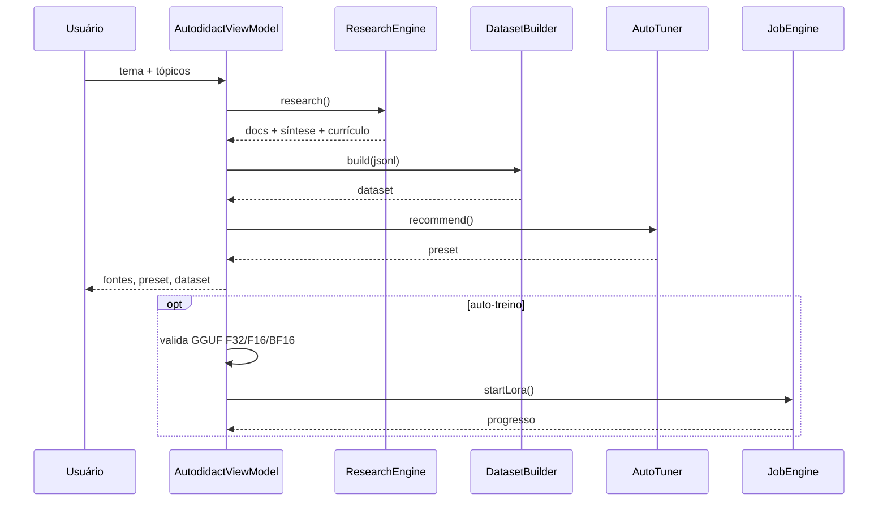

# Arquitetura

## Visão geral

O Girassol é um app Android nativo (Kotlin + Compose) que executa todo o ciclo de vida de um modelo local:

```text
GGUF → inspeção → imatrix → quantização
                     ↘
tema → pesquisa → dossiê → currículo → dataset → auto-tuning → LoRA/fine-tune
```

Nada é enviado a um backend do Girassol. As únicas chamadas externas são as APIs de pesquisa e o endpoint de LLM que o usuário configurar.

## Camadas

### UI (`ui/`)

- `AppRoot` controla rotas, animações e a barra inferior.
- `LabScreen` agrupa **Quantizar**, **Imatrix** e **Treinar**.
- `AutodidactPane` é a bancada de autoestudo.
- `CodexScreen`, `AgentScreen`, `LlamatikScreen`, `ModelsScreen`, `ModelDetailScreen`, `SettingsScreen`.
- Componentes visuais em `ui/components` (aurora, anéis, donut, barras, spinner de girassol).
- Tema em `ui/theme/Theme.kt` (paleta `Lab`).

### ViewModels (`vm/`)

- `LabViewModel`: catálogo, quantização, imatrix, treino, jobs e memória.
- `AutodidactViewModel`: pesquisa → dataset → preset → auto-treino.
- `AgentViewModel`: chat ReAct, streaming, histórico.
- `CodexViewModel`: plano e execução do agente de código.
- `LlamatikViewModel`: runtime do SDK, console e tools.

ViewModels não fazem I/O de rede na main thread; usam `viewModelScope` + `Dispatchers.IO`.

### Pesquisa (`core/research/`)

`ResearchEngine.research(theme, count, perTopic)`:

1. limpa o tema;
2. consulta em paralelo:
   - Wikipedia PT/EN;
   - OpenAlex;
   - arXiv;
   - Stack Overflow;
   - DuckDuckGo;
   - Semantic Scholar (best effort);
3. normaliza e deduplica por URL/título;
4. ranqueia por relevância + BM25;
5. salva o dossiê em `files/research/`;
6. gera síntese:
   - com LLM: resumo/currículo;
   - sem LLM: extrativo, ancorado nos trechos.

`Bm25` implementa índice invertido, IDF e pontuação para RAG local.

### Dataset (`core/train/DatasetBuilder.kt`)

Gera JSONL no formato chat:

```json
{"messages":[{"role":"system","content":"..."},{"role":"user","content":"..."},{"role":"assistant","content":"..."}]}
```

Fonte: pares pergunta/resposta do currículo, com contexto das fontes. O dataset é gravado em `files/autodidact/`.

### Auto-tuning (`core/train/AutoTuner.kt`)

Calcula:

- rank/alpha a partir do tamanho do corpus;
- epochs por tamanho e tempo disponível;
- learning rate;
- contexto;
- módulos alvo;
- ETA usando throughput estimado (`Perf`).

O preset é enviado para a aba Treinar via `AppSelection`.

### Motor nativo (`core/native/` + `cpp/`)

`liblabforge.so` liga o llama.cpp **0.9.0-dev** e expõe:

| JNI | Função |
|---|---|
| `nativeVersion` | versão do backend |
| `nativeCountTokens` | contagem nativa |
| `nativeTokenStats` | estatísticas de tokens |
| `nativeQuantize` | `llama_model_quantize` com imatrix |
| `nativeFinetune` | treino completo (AdamW) |
| `nativeLoraTrain` | LoRA com base congelada + A/B |

Bibliotecas empacotadas em `app/src/main/jniLibs/arm64-v8a/`:

- `liblabforge.so`
- `libllama.so`
- `libllama-common.so`
- `libggml.so`, `libggml-base.so`, `libggml-cpu.so`
- `libc++_shared.so`

O build CMake fica em `app/src/main/cpp/CMakeLists.txt`; o script `scripts/build-native.sh` reconstruciona com NDK 26.1.

### Jobs (`core/job/JobEngine.kt`)

Fila serializada de trabalhos longos (quantização/treino), com:

- progresso, ETA, cancelamento;
- `GirassolService` em foreground para sobreviver ao background;
- notificação e `JobStrip` na UI;
- `MemoryGuard` antes de alocar.

### Agentes

- `ReActAgent`: loop pensamento → ação → observação, 12 ferramentas.
- `AgentTools`: shell, arquivos, Git, HTTP, pesquisa, cálculo, data, Python etc.
- `CodexEngine`: plano, edição, diff, execução e revisão.
- `LlamatikRuntime`: tools do SDK, executor, permissões, memória e streaming.

### Integração Llamatik

```text
LlamatikRuntime
 ├── ToolRegistry (built-ins + PublicApiTool + ResearchTool)
 ├── AgentExecutor (permissions, action log, entitlement)
 ├── PersistentMemory (FileMemoryStorage)
 └── stream() → Flow<AgentStreamChunk>
```

`LlamatikToolBridge` registra as tools do SDK no ReAct, para que o Chat também as enxergue.

## Fluxo do autoestudo



## Decisões

### `com.llamatik:core` excluído

O SDK do Llamatik oferece um core nativo com llama.cpp próprio. O Girassol já tem um llama.cpp com APIs de treino/quantização. Os SONAMEs colidem. A exclusão é deliberada e testada.

### `targetSdk 34`

Mantido em 34 para evitar regressões de edge-to-edge e restrições novas de foreground service. `compileSdk 37` é exigido pelo AAR do Llamatik.

### Pré-built `.so`

As bibliotecas nativas são versionadas no repositório para que o CI consiga montar o APK sem baixar/compilar o llama.cpp inteiro (que excede a RAM de runners menores). Rebuild local:

```bash
ANDROID_NDK_HOME=$ANDROID_HOME/ndk/26.1.10909125 JOBS=2 ./scripts/build-native.sh
```

## Segurança

- Sem telemetria.
- Chaves de API ficam em `SharedPreferences`/DataStore locais.
- Shell e arquivos só operam no sandbox do app (ou no diretório que o usuário escolher).
- O app é destinado a dispositivo controlado; ferramentas de shell são intencionais.
- `AgentActionLogRepository` registra ações do agente.

## Limitações

- arm64 apenas.
- LoRA nativo exige F32/F16/BF16.
- LLM local no dispositivo depende do modelo e da RAM.
- APIs gratuitas têm rate limit e cobertura variável.
- A debug keystore é usada no APK de CI.
